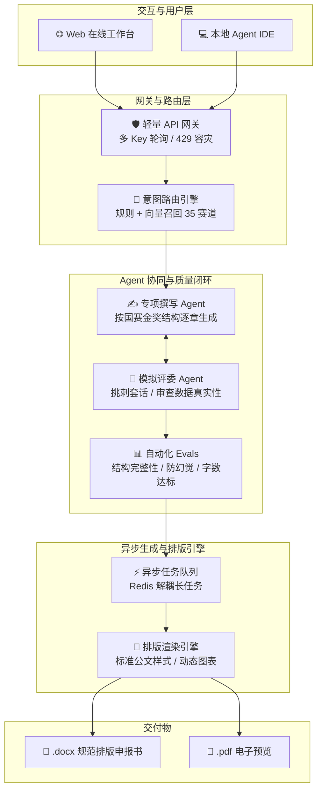

# Awesome Student AI Skills

[](https://merx.help/shield)

### 35 个大学生申报书 AI Skill · 一句话生成可直接提交的规范 Word 文档

[](https://github.com/cuic19053-hue/awesome-student-ai-skills/stargazers)
[](./LICENSE)
[](https://agent.stardust.website)
[](https://agentskills.io/specification)

> 大创、挑战杯、互联网+、国奖、励志奖学金、保研推免、三下乡、入团申请书……
>
> **不用学提示词，不用装环境，不用会编程。** 把你要写的东西说清楚，AI 追问你缺失的信息，然后吐出一份带红头、表格、签字栏、技术路线图的 `.docx`。

**覆盖 8 大类 · 35 种申报材料**，源自挑战杯国赛真实打磨，抖音单条视频自然流 **8,000+ 赞 / 6,000+ 收藏**（[看演示](https://www.douyin.com/video/7692700167341985051)）。

[简体中文](./README.md) | [English](./README_EN.md)

---

## ⚡ 30 秒开始（推荐，什么都不用装）

| 步骤 | 你要做的 |
|:---:|---|
| **1** | 打开 👉 **[agent.stardust.website](https://agent.stardust.website)** |
| **2** | 打字：「帮我写一份大创创新训练申报书，我的课题是无人机路径规划」 |
| **3** | 按 AI 的追问补全信息（排名、指导老师、预算……）→ 点导出，拿到 `.docx` |

就这样。**没有 Python，没有命令行，没有 API Key，没有配置文件。**

> ⚠️ 在线版导出的是**草稿**：排版和内容需要你对照本校通知逐项核对后再提交。这是刻意设计 —— 我们不替你编造事实。

---

## 📄 先看成品长什么样

不信？直接下载 10 份已经排好版的真实 `.docx`，用 Word 打开看结构，再决定要不要用：

| 类别 | 样例下载 |
|---|---|
| 国家级科研 | [📄 大创创新训练申报书](https://github.com/cuic19053-hue/awesome-student-ai-skills/raw/main/examples/demos/demo_innovation_research.docx) · 红头公文、三段式科学挑战、算法对比表、3 张技术路线图、经费预算表 |
| 国赛竞赛 | [📄 挑战杯课外学术作品申报书](https://github.com/cuic19053-hue/awesome-student-ai-skills/raw/main/examples/demos/demo_challenge_cup.docx) · 30+ 篇文献综述、金奖立项逻辑链、三级评审意见栏 |
| 双创商业 | [📄 互联网+ 商业计划书](https://github.com/cuic19053-hue/awesome-student-ai-skills/raw/main/examples/demos/demo_internet_plus.docx) · 4P+3C+SWOT 闭环、5 年财务三表、股权结构 |
| 顶级奖学金 | [📄 国家奖学金申请书](https://github.com/cuic19053-hue/awesome-student-ai-skills/raw/main/examples/demos/demo_national_scholarship.docx) · 对齐财教最新评定政策、成绩排名证明、突出贡献 |
| 升学保研 | [📄 保研推免个人陈述](https://github.com/cuic19053-hue/awesome-student-ai-skills/raw/main/examples/demos/demo_graduate_recommendation.docx) · 表格体+陈述体双结构、亮点量化 |
| 创客训练 | [📄 大创创业训练申报书](https://github.com/cuic19053-hue/awesome-student-ai-skills/raw/main/examples/demos/demo_entrepreneurship_training.docx) · 商业模式画布、专利壁垒、甘特进度 |
| 新手科研 | [📄 院级科研立项申请书](https://github.com/cuic19053-hue/awesome-student-ai-skills/raw/main/examples/demos/demo_college_research.docx) · 16 栏目标准公文表格体 |
| 校级科研 | [📄 校级科研立项申报书](https://github.com/cuic19053-hue/awesome-student-ai-skills/raw/main/examples/demos/demo_university_research.docx) · 22 栏目、15+ 篇文献综述、数学公式规范 |
| 综合评优 | [📄 优秀毕业生申报书](https://github.com/cuic19053-hue/awesome-student-ai-skills/raw/main/examples/demos/demo_outstanding_graduate.docx) · 四年成长叙事、五维度量化实绩 |
| 公派留学 | [📄 CSC 公派留学申请书](https://github.com/cuic19053-hue/awesome-student-ai-skills/raw/main/examples/demos/demo_csc_scholarship.docx) · 研修计划可行性、外导对接、归国承诺 |

---

## 🎯 它能帮你写什么

| 你要交的材料 | 输出物 |
|---|---|
| **大创申报书**（创新训练 / 创业训练 / 创业实践） | 含技术路线图、甘特图、算法对比表的完整 Word |
| **挑战杯申报书**（课外学术科技作品） | 含 30+ 篇文献综述、创新点提炼的 Word |
| **互联网+ 商业计划书**（主赛道 / 红旅赛道） | 含商业模式闭环、市场分析的 Word |
| **国家奖学金 / 励志 / 校级 / 企业 / 单项 / 助学金** | 对齐各校评审偏好的 Word |
| **保研推免 / 选调生 / 优秀毕业生 / 优秀毕业论文** | 含简历式亮点提炼的 Word |
| **三下乡社会实践报告**（社会调查 / 支教 / 政策宣讲 / 科技服务） | 含数据图表的社会实践报告 |
| **入团申请书 / 思想汇报 / 转正申请** | 规范格式的政治材料 |
| 校级院级科研立项、西部计划、公派留学、转专业、应征入伍 | 对应赛道的规范 Word |

<details>
<summary><b>📚 展开完整 35 个赛道清单（含内容量）</b></summary>

> ✅ 已完备（可直接使用）｜ 🔄 持续打磨中

**🔬 项目类（要钱、要立项）· 9 个**

| # | 赛道 | 编码 | 内容量 |
|---|---|---|---|
| 1 | 大创 · 创新训练项目 | `innovation-research` | 117 KB |
| 2 | 大创 · 创业训练项目 | `entrepreneurship-training` | 112 KB |
| 3 | 大创 · 创业实践项目 | `entrepreneurship-practice` | 52 KB |
| 4 | 校级科研立项 | `university-research` | 102 KB |
| 5 | 院级科研立项 | `college-research` | 99 KB |
| 6 | 挑战杯 · 课外学术科技作品 | `challenge-cup` | 111 KB |
| 7 | 互联网+ · 商业计划书 | `internet-plus` | 93 KB |
| 8 | 互联网+ · 红旅赛道 | `internet-plus-red-tour` | 79 KB |
| 9 | 国家级项目立项逻辑评测 | `national-project-eval` | 39 KB |

**🏆 评优类（要荣誉）· 12 个**

| # | 赛道 | 编码 | 内容量 |
|---|---|---|---|
| 10 | 国家奖学金（10000 元） | `national-scholarship` | 37 KB |
| 11 | 国家励志奖学金（6000 元） | `motivation-scholarship` | 44 KB |
| 12 | 校级奖学金 | `university-scholarship` | 40 KB |
| 13 | 企业专项奖学金 | `enterprise-scholarship` | 47 KB |
| 14 | 单项奖学金 | `single-scholarship` | 44 KB |
| 15 | 国家助学金 | `grant-application` | 75 KB |
| 16 | 优秀毕业生 | `outstanding-graduate` | 46 KB |
| 17 | 优秀学生 / 三好学生 | `outstanding-student` | 58 KB |
| 18 | 优秀学生干部 | `outstanding-cadre` | 87 KB |
| 19 | 文明大学生 / 优秀团员 | `civilized-student` | 60 KB |
| 20 | 优秀班集体 | `class-collective` | 67 KB |
| 21 | 优秀毕业设计 / 论文 | `outstanding-thesis` | 73 KB |

**🌾 活动类 · 5 个**

| # | 赛道 | 编码 | 内容量 |
|---|---|---|---|
| 22 | 三下乡 · 社会调查 | `social-survey` | 46 KB |
| 23 | 三下乡 · 支教 | `volunteer-teaching` | 48 KB |
| 24 | 三下乡 · 政策宣讲 | `policy-lecture` | 54 KB |
| 25 | 三下乡 · 科技服务 | `tech-service` | 63 KB |
| 26 | 西部计划 | `western-plan` | 75 KB |

**🚩 政治身份类 · 3 个**

| # | 赛道 | 编码 | 内容量 |
|---|---|---|---|
| 27 | 入团申请书 | `youth-league-application` | 72 KB |
| 28 | 阶段汇报 / 思想汇报 | `summary-report` | 26 KB |
| 29 | 转正申请书 | `youth-league-conversion` | 26 KB |

**🎓 升学类 · 2 个**

| # | 赛道 | 编码 | 内容量 |
|---|---|---|---|
| 30 | 保研推免申请 | `graduate-recommendation` | 43 KB |
| 31 | 选调生申请 | `selected-graduate` | 68 KB |

**✈️ 公派留学 / 交流类 · 2 个**

| # | 赛道 | 编码 | 内容量 |
|---|---|---|---|
| 32 | CSC 国家公派留学 | `csc-scholarship` | 66 KB |
| 33 | 交流项目申请 | `exchange-program` | 90 KB |

**📋 其他 · 2 个**

| # | 赛道 | 编码 | 内容量 |
|---|---|---|---|
| 34 | 转专业申请 | `major-transfer` | 79 KB |
| 35 | 应征入伍申请书 | `military-enlistment` | 73 KB |

</details>

---

## ❓ 你可能担心的三件事

**「AI 会不会替我编造奖项和经历？」**
不会。这是整个项目的底线设计：AI 先问清你的真实信息再动笔，缺信息必须追问，绝不写「获得多项荣誉」这种空话。写「班级第二」就是「班级第二」，不会给你润色成「名列前茅」。**但提交前请务必自己逐项核对。**

**「要收费吗？要自己配 API Key 吗？」**
不要。在线版和本地版都免费，也不需要你申请模型 Key。

**「我不会编程，能用吗？」**
能 —— 就是上面那 3 步。仓库里的 Python 脚本、MCP 配置、私有化部署**全部是给你身边会编程的同学或者开发者看的**，普通使用完全碰不到。

**「和直接问 ChatGPT 有什么区别？」**
通用大模型不知道各赛道的评审标准和硬性格式（字数、文献数量、栏目顺序、政治表述），而且喜欢编事实。这个项目把 35 个赛道的评审逻辑、字数硬规则、文献要求、格式规范固化成结构化知识，运行时按需加载，并且直接输出排好版的 `.docx` 而不是一堆需要你手动搬的文字。

**「我的个人信息会被上传吗？」**
在线版：材料保存在你的账号下，自定义模型 Key 按账号加密。本地版：一切保存在本机 `.agent-data/`，用本机 Ollama 推理。注意：你主动触发搜索官方通知时，搜索关键词会发到公开搜索服务。

---

## 🔍 为什么可信

- **不是实验室玩具**：团队打挑战杯从校赛一路冲进国赛，申报书磨了十几轮，这套东西是先解决自己的问题长出来的。
- **经过真实流量验证**：抖音一条视频，**0 推广**，一周内 **8,000+ 赞、6,000+ 收藏、1,400+ 转发**（[原视频](https://www.douyin.com/video/7692700167341985051)）—— 说明「不知道评委想看什么」是普遍真痛点。
- **不是凭空编的规范**：拆解了上百篇国家级金奖 / 一等奖真实申报书，提炼评审逻辑与格式规范，**不包含任何受版权保护的原文段落**。

---

## 💻 进阶用法（开发者向，普通用户可跳过）

以下全部需要一定的命令行基础。只想写申报书的同学，上面的 30 秒路径已经够了。

<details>
<summary><b>① 在本地 Agent IDE 里用（WorkBuddy / Claude Code / Codex / Cursor / Trae）</b></summary>

1. 克隆仓库，安装依赖：`pip install -r utils/requirements.txt`（提供 `python-docx` 等底层依赖）
2. 把根目录 `SKILL.md`（或具体赛道 `subskills/<赛道>/SKILL.md`）作为**系统提示词**喂给 AI
3. 直接说：「我想写一份大创申请书」

AI 会做三件事：交互式追问你的真实信息 → 调用 `utils/dispatcher.py` 决策树匹配赛道 → 执行 `subskills/<赛道>/build.py`，把 JSON 数据渲染成带标准字号、表格、签字栏的 `.docx`。

</details>

<details>
<summary><b>② MCP 服务接入（Claude Desktop / Cursor / Codex）</b></summary>

仓库自带标准 MCP Server（`mcp_server.py`），暴露 7 个工具：赛道路由、信息采集、评委盲审打分、Word 渲染等。

```json
{
  "mcpServers": {
    "student-skills": {
      "command": "python3",
      "args": ["<你的项目绝对路径>/mcp_server.py"]
    }
  }
}
```

或用 `uv` 免配虚拟环境：

```json
{
  "mcpServers": {
    "student-skills": {
      "command": "uv",
      "args": ["--directory", "<你的项目绝对路径>", "run", "mcp_server.py"]
    }
  }
}
```

</details>

<details>
<summary><b>③ 指定学校版式（<code>--school</code>）</b></summary>

各校模板在栏目顺序、字号、页边距上有微调。项目按「先出内容、再套版式」两层工作：

```bash
python subskills/national-scholarship/build.py \
  --data my_info.json \
  --school pku \
  --out 国家奖学金申请书.docx
```

`--school` 支持英文缩写 / 中文全称 / 简称（`pku` / `北京大学` / `北大` / `THU` 均可）。已收录 `pku`、`tsinghua`、`whu`、`zju`；传入未收录的学校会提示清单并按默认版式输出，**不会静默降级**。

想加自己学校：复制 `utils/schools/template_default.json` 为 `template_<学校id>.json` 改好即可。

</details>

<details>
<summary><b>④ 私有化本地部署（局域网自建 + Ollama 本地模型）</b></summary>

数据完全不出内网。部署方法、数据库配置、已知限制见 [`server/README.md`](./server/README.md)。

⚠️ 实验版尚不适合未经身份验证和数据隔离审查就作为多人公网服务使用。

</details>

<details>
<summary><b>⑤ 没有任何工具时的土办法：直接粘网页 AI</b></summary>

1. 打开豆包 / DeepSeek / Claude 等网页版
2. 在 [`subskills/`](./subskills/README.md) 找到需要的赛道，复制 `SKILL.md` 全文
3. 粘进对话框：「我要申请 xxx，请按这个 skill 帮我写」

⚠️ 网页 AI 只输出纯文本，没有图片和 Word 排版。

</details>

<details>
<summary><b>🏗️ 系统架构（为什么长文本不崩）</b></summary>

为了解决大模型写长文档时的「上下文漂移」「幻觉套话」「生成超时」，系统做了分层设计：

<div align="center">
  
</div>



三层加载（Agent Skills 规范）：**元数据层** ~100 tokens 只载 name/description → **指令层** 匹配后才载 SKILL.md 正文 → **资源层** 执行中按需载 `references/`。35 个 skill 不会全塞进上下文。

</details>

<details>
<summary><b>📁 项目结构</b></summary>

```
awesome-student-ai-skills/
├── subskills/               # 35 个赛道 skill（核心资产）
│   ├── innovation-research/SKILL.md    # 大创 · 创新训练
│   ├── national-scholarship/SKILL.md   # 国家奖学金
│   └── ...（共 35 个）
├── references/              # 共享知识库
│   ├── writing_guide.md     # 撰写规范
│   ├── review_criteria.md   # 评审打分维度
│   └── pitfalls.md          # 常见错误与避坑
├── examples/demos/          # 10 个成品 .docx（直接下载）
├── SKILL.md                 # 路由入口：识别类型 → 分流子 skill
├── index.json               # 机器可读索引
└── utils/                   # dispatcher / docx_common / schools / pdf_export
```

根 `SKILL.md` 是**路由器**，不直接生成内容：识别类型 → 不确定时列候选让你确认 → 移交对应子 skill。

</details>

---

## 📅 Star 解锁路线图

> 已达 100 ⭐，「讲莲杯 / 创青春 / 三创赛」进入开发队列。**点 Star = 催更。**

| 里程碑 | 解锁赛道 |
|---|---|
| ⭐ 300 | 节能减排大赛、生命科学竞赛（学科专项类） |
| ⭐ 500 | 服务外包大赛、商业精英挑战赛（商科类） |
| ⭐ 1000 | 师范生教学技能、英语类竞赛 |

---

## 🤝 交流 & 合作

- 👥 **大学生科创交流群**：大创 / 挑战杯 / 互联网+ 备赛避坑、AI 辅助立项、格式规范
- 🤝 **深度合作 / 1v1**：立项逻辑链重构、技术路线图、商业计划书漏洞诊断、赛事辅导

<div align="center">
  
  <p>👉 扫码加微信（进群备注 <b>进群</b> ｜ 合作私聊 <b>合作+具体需求</b>）</p>
</div>

---

## 🚫 这不是什么东西

- 不是「一键生成完美申报书」的魔法按钮 —— 你得提供真实经历和数据
- 不是政策咨询工具 —— 不解读各校评审规则的变化
- 不保证中标 —— 结果取决于你的实际条件和评审偏好
- 不是学术不端工具 —— 不帮你编造论文、奖项、经历

---

## 免责声明

**本项目按「现状」提供，仅供学习和参考。**

1. **非官方出品**：与任何高校、教育主管部门、评审委员会无关。评审标准与格式规范基于公开信息和社区经验整理，不构成官方指导意见。
2. **真实性由使用者负责**：生成的申报材料，其真实性和准确性由使用者本人承担全部责任。虚假申报可能面临学籍处分乃至法律责任。
3. **不保证结果**：不承诺通过评审、获得立项或拿到奖学金。
4. **格式以学校模板为准**：各校模板在栏目顺序、字数、排版上可能不同，提交前请对照本校要求逐项检查。
5. **政治类文书的特殊性**：参考内容不构成政治立场建议，政治表述的准确性由申请人承担全部责任。
6. **责任豁免**：在法律允许的最大范围内，作者及贡献者不对因使用或无法使用本项目产生的任何直接、间接或后果性损害承担责任。
7. **合规使用**：请遵守所在国家/地区及学校的法律法规。如使用行为违反相关规定，请立即停止并删除本项目。

**使用本项目即表示你已阅读、理解并同意上述声明。**

---

## 致谢

感谢 [@richyhu](https://github.com/richyhu) 完成了本项目绝大部分编写工作。从每一个栏目到每一条避坑指南，都来自他对高校申报体系的深入理解和大量实践。这不是写 prompt，而是把散落在各高校通知文件里的隐性领域知识系统性编码为 Agent 可执行的指令 —— 在国内 Agent Skills 生态里非常稀缺。

## 贡献

欢迎 Issue 和 PR。特别是：某校模板有特殊要求、某申报类型评审标准更新（如互联网+ 2026 新规）、Skill 输出有事实性错误。

贡献前请读 `references/writing_guide.md`，确保修改符合项目的**诚实底线**。

## 许可

MIT License —— 随便用、随便改，但请保留原作者署名和免责声明。详见 [LICENSE](./LICENSE)。

## 💻 Windows 编码约定

- 推荐启用 UTF-8：Windows 控制台执行 `set PYTHONUTF8=1`，PowerShell 执行 `$env:PYTHONUTF8=1`。
- 所有子技能的 `build.py` 已内置 GBK 流容错，即使在未开 UTF-8 的原生 GBK 终端下也会安全降级，不会因 Unicode 状态符号抛 `UnicodeEncodeError`。

---

## 📈 Star History

[](https://star-history.com/#cuic19053-hue/awesome-student-ai-skills&Date)

---

*用这个项目写出了好申报书，或者踩了什么坑，欢迎提 Issue 分享 —— 让后面的人少走弯路。*
