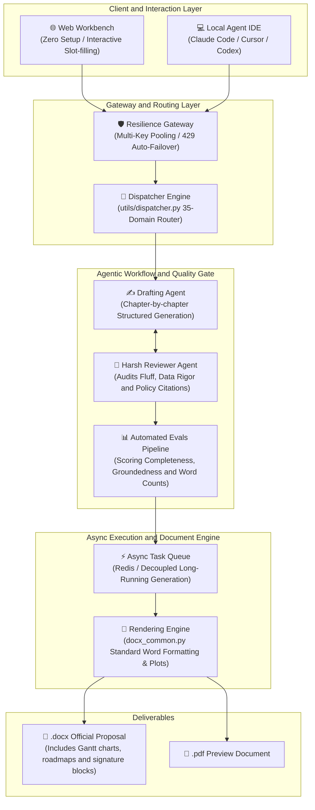

# Awesome Student AI Skills

[](https://awesome.re)
[](https://agentskills.io/specification)
[](https://www.douyin.com/video/7692700167341985051)
[](https://www.douyin.com/video/7692700167341985051)
[](https://www.douyin.com/video/7692700167341985051)
[](https://agent.stardust.website)
[](#)
[](./LICENSE)

> *“An Enterprise-Grade LLM Agent Workflow Framework for academic & grant proposals. Born from real-world National Gold Award competition teams and validated by over 8,000+ university students. Features intent routing, chapter-by-chapter co-authoring, strict anti-hallucination constraints, and native `.docx` document rendering.”*

[简体中文](./README.md) | [English](./README_EN.md)

> 🌐 **Try it online:** [agent.stardust.website](https://agent.stardust.website) (Zero setup, instant browser access)
> 🎬 **Douyin Demo Video (Direct Link):** [Watch on Douyin / TikTok China](https://www.douyin.com/video/7692700167341985051)
> 🌟 **If this project helps with your academic proposals or research grants, please consider giving us a Star ⭐️! Your support keeps this open-source project moving forward.**
>
> 🚀 **Quick links:** 🌐 [Online Workbench](https://agent.stardust.website) · 🚀 [Quick Start](#-how-to-use) · 🎬 [Demo Video](https://www.douyin.com/video/7692700167341985051) · 🏗️ [Architecture](#-system-architecture) · 💡 [Background & PMF](#-background--pmf-validation) · 📋 [35 Skills](./README.md#能写哪些申报书)

---

## 💡 Background & PMF Validation

This project is not an academic toy—it is a **battle-tested commercial MVP built from real-world competition pain points**:

1. **Originating from National Competitions**: The creators participated in national-level innovation contests ("Challenge Cup"), iterating on proposals dozens of times to meet strict judging criteria.
2. **Zero-CAC Organic Virality**: Released organically on Douyin (TikTok China), generating **8000+ likes, 6100+ high-intent bookmarks, and ~1400+ shares within 7 days** with zero advertising spend (🎬 [Watch Viral Demo Video](https://www.douyin.com/video/7692700167341985051)), validating strong authentic demand among university students.

---

## 🏗️ System Architecture

<div align="center">
  
</div>

<details open>
<summary><b>🔍 View / Collapse Mermaid Architecture Source</b></summary>



</details>

---

## 📖 Table of Contents

- [What is this?](#what-is-this)
- [How to Use](#how-to-use)
- [Agent Workbench (Experimental)](#agent-workbench-experimental)
- [Architecture & Design](#architecture--design)
- [List of 35 Skills](#list-of-35-skills)
- [Contributing](#contributing)
- [License](#license)

---

## 🎯 Trained on Classic Award-Winning Cases

This framework is not built on empty assumptions. It has been **deeply trained on hundreds of real-world National Gold Award / First Prize winning proposals** (covering core competitions like Innovation Research, Internet+, and Challenge Cup).
We have distilled the top-tier logic of winning works—such as "pain-point quantification", "business model closed-loops", "innovation extraction", and "technical roadmap design"—and solidified them into "hard constraints" via complex Prompt Engineering. What you generate is not just a document, but a winning strategy aligned with a top-tier perspective.

## 💡 Core Agent Architecture & Value Proposition

This is **not just another prompt repository**. It's an Enterprise-Grade Sovereign Prompt Stack that encapsulates complex domain workflows into an **Agent Router and CLI utilities**. 

By feeding these 35 `SKILL.md` files into any Agent-compatible AI tool, the AI automatically acts as a domain expert:
1. **Multi-turn Intent Parsing & Slot Filling**: Uses Chain-of-Thought (CoT) to rigorously extract key entity information based on structured schemas.
2. **Anti-Hallucination & Value Alignment**: Strictly refuses to hallucinate fake awards or data, ensuring absolute fact-checking.
3. **Dynamic Decision Routing**: Underlying decision-tree logic accurately matches user natural language to one of 35 candidate domains.
4. **End-to-End Document Rendering Loop**: Abstract JSON data is transformed into physical `.docx` files via background scripts, automatically handling Markdown degradation, tables, and Mermaid/Matplotlib generation.

---

## 🚀 How to Use

We provide **three ways** to use this project depending on your needs:

| Mode | Best For | Key Features | Quick Access |
| :--- | :--- | :--- | :--- |
| 🌐 **Online Workbench** *(Recommended)* | End Users / Quick Drafting | Zero installation, browser-based, visual chapter editing & export | 👉 **[agent.stardust.website](https://agent.stardust.website)** |
| 💻 **Local Agent IDE** | Developers / Power Users | Integrated with Claude Code / Cursor / Codex, privacy-first offline | See [Local Workflow](#mode-2-local-agent-ide-workflow) |
| 🛠️ **Self-Hosted Instance** | Privacy / Offline LLMs | Run local full-stack WebUI with Ollama backend | See [`server/README.md`](./server/README.md) |

---

### Mode 1: Online Agent Workbench (Zero-Setup, Recommended)

> 🌐 **Online entry:** [agent.stardust.website](https://agent.stardust.website)  
> 📖 **Deployment & configuration guide:** [`server/README.md`](./server/README.md)

No local Python environment required. Directly interact in your browser to experience full Agent capabilities:
- **Dynamic Intent Routing**: Natural-language routing across 35 competition & proposal tracks.
- **Fact-Grounding & Anti-Hallucination**: Material verification & OCR, automatically marking unverifiable claims as "to be supplemented".
- **Collaborative Chapter Drafting**: Section-by-section iterative polishing and customization.
- **One-Click Word Export**: Generates compliant `.docx` drafts directly.

---

### Mode 2: Local Agent IDE Workflow
1. **Prepare Environment**: Download an AI Agent IDE that supports local Python execution (e.g., **WorkBuddy, Codex, Claude Code, Trae Work**).
2. **Clone the Project**: Clone this project locally and run `pip install -r utils/requirements.txt` in your terminal (to install underlying dependencies like `python-docx`).
3. **Load the Skill**: In your AI tool, feed the root `SKILL.md` (or a specific subskill like `subskills/innovation-research/SKILL.md`) into the AI as the **System Prompt**.
4. **Start the Conversation**: Simply say to the AI: *"I want to write an innovation research proposal."*

### Agent Execution Loop
The AI will automatically handle intent parsing, dynamic routing, fact validation, and finally invoke the `build.py` script to render the `.docx` document in your local environment.

---

### 🔌 MCP Server Integration (Model Context Protocol)

This repository includes a native Model Context Protocol (MCP) server (`mcp_server.py`) exposing 7 standardized tools for intent routing, requirement collection, simulated jury review, and automatic `.docx` Word rendering.

#### Quick Setup for Claude Desktop / Cursor
Add the following to your `claude_desktop_config.json` or Cursor MCP settings:

```json
{
  "mcpServers": {
    "student-skills": {
      "command": "python3",
      "args": ["/absolute/path/to/awesome-student-ai-skills/mcp_server.py"]
    }
  }
}
```
Or run via `uv`:
```json
{
  "mcpServers": {
    "student-skills": {
      "command": "uv",
      "args": ["--directory", "/absolute/path/to/awesome-student-ai-skills", "run", "mcp_server.py"]
    }
  }
}
```
Once connected, your AI assistant can naturally route and invoke all 35 skills directly from your conversation.

---

## 🧪 Agent Workbench (Experimental)

> 🌐 **Try it online:** [agent.stardust.website](https://agent.stardust.website)  
> 📖 **Self-Hosting & Development:** [`server/README.md`](./server/README.md)

The original 35-skill library and IDE workflow remain available. In addition, the repository now includes a browser-based **Agent Workbench**, expanded from the local Innovation Training Agent prototype. It offers natural-language skill routing, material review, section-by-section drafting, and Word draft export.

See [`server/README.md`](./server/README.md) for local setup, model configuration, storage, and known limitations. The workbench is still experimental: skill-specific forms and each `build.py` formatter are being integrated incrementally. Generated documents are drafts and must be checked against current school requirements.

---

## 🧠 Architecture & Design

Our `utils/` folder provides 7 core engineering modules shared across all 35 subskills:

| Module | Lines | Function |
|--------|-------|----------|
| `dispatcher.py` | 837 | 5-level decision tree router + keyword matching + interactive CLI |
| `docx_common.py` | 897 | Shared docx generator (margins/fonts/tables/signatures/pagination) |
| `school_template.py` | 760 | Format adapters for 5 specific universities (PKU, THU, WHU, ZJU, etc.) |
| `pdf_export.py` | 1036 | docx → PDF conversion engines |
| `plagiarism_checker.py`| 742 | n-gram duplication check + report generation |
| `review_simulator.py` | 1089 | Simulates committee reviews & scoring based on `review_criteria.json` |

Read our [Architecture Design Document (ZH)](./docs/design/ARCHITECTURE.md) and [Agent Prompt Design (ZH)](./docs/design/AGENT_DESIGN.md) for more details.

---

## 📋 List of 35 Skills

The repository currently supports 35 highly specialized proposal types across 9 categories. Here are a few notable ones:

*   🔬 **Research (大创/挑战杯)**: `innovation_research`, `entrepreneurship_training`, `challenge_cup`
*   🏆 **Scholarships (奖学金)**: `national_scholarship`, `motivation_scholarship`, `enterprise_scholarship`
*   🌾 **Social Practice (三下乡)**: `social_survey`, `volunteer_teaching`, `policy_lecture`
*   ✈️ **Study Abroad (公派留学)**: `csc_scholarship`, `exchange_program`

*See the [Chinese README](./README.md) for the full list of all 35 skills.*

---

## 🤝 Contributing

We welcome Issues and PRs! If you find:
- A school's specific template formatting needs tweaking.
- Outdated review criteria (e.g. new "Internet+" 2026 rules).
- Factual errors in the AI's output instructions.

Please let us know. Be sure to read `references/writing_guide.md` before contributing to align with our absolute "Honesty First" baseline.

---

## 📄 License

MIT License — feel free to use, modify, and build upon this project. We only ask that you retain the original authorship and disclaimer. See [LICENSE](./LICENSE).

---

## 📈 Star History

[](https://star-history.com/#cuic19053-hue/awesome-student-ai-skills&Date)
